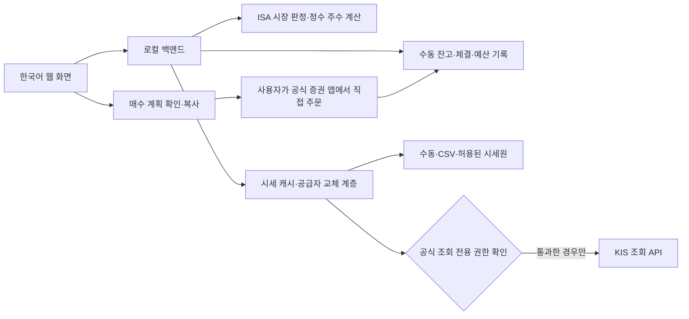

# ISA 투자전략·포트폴리오 웹앱 통합 개발계획서

이 문서는 확정된 ISA 적립식 투자전략, 포트폴리오 관리 기능, KIS Developers 조회 전용 연동 조건을 하나의 개발 기준으로 통합한다. 투자 판단·매수 계획·기록은 앱에서 지원하고, 실제 주문은 사용자가 한국투자증권 공식 앱에서 직접 실행한다.

**현재 개발 범위에는 매수·매도·정정·취소 주문 API가 없다. 실전 App Key/Secret은 증권사 차원의 조회 전용 권한이 공식 확인되기 전까지 시세 조회 목적이라도 연결하지 않는다. 비밀정보를 채팅·저장소·문서·로그에 보관하지 않는다.**

## 1. 기준 자료와 결정의 우선순위

- 기준일: 2026-11-09, 한국시간.
- 기존 소스: [rebalance-backend](https://github.com/tosvel123-del/rebalance-backend).
- 확인한 소스 기준 커밋: 55206f16b9e6c6ccb9de8a69a065df781e0fb0c9.
- 투자 기준 원본: [ISA 투자계획 V2.3](ISA_INVESTMENT_PLAN_V2.3_20261109.md).
- 원본 백업: [V2.3 통합 개발계획 작성 전 백업](backups/ISA_INVESTMENT_PLAN_V2.3_20261109.before-development-plan.md).
- 이 문서는 기존 투자보고서를 삭제하거나 소급 변경하지 않고, 개발에 필요한 규칙과 우선순위를 추가한 독립 버전이다.

| 구분 | 적용 기준 |
|---|---|
| 확정 투자전략 | 기존 V2.3의 5 ETF, 시장별 비중·납입금, 화·목 분할 |
| 최신 보안·갱신 요구 | 이번 요청의 직접 주문, 실전 키 연결 금지 조건, REST 갱신 간격 |
| 과거 대화의 임시 계산·후보 | 특정 날짜의 매수 수량·가격, PLUS/RISE 머니마켓 대안은 기본 전략으로 자동 채택하지 않음 |
| 본 문서의 구현 제안 | 계산 목적함수, 데이터 구조, 화면·배포 방식은 개발 명세로 제시하며 기존 투자 합의와 구분 |
| 미래 실험 | 하락일 매수·2거래일 연속 상승 후 다음날 매수는 연구용 시뮬레이션만 허용 |

충돌 시 현재 사용자 요청의 보안 원칙을 최우선으로 적용한다. 과거의 “시세만 조회하면 실전 키를 써도 된다”는 해석, 화요일 한 번에 전액 매수하는 초기안, 자동주문 가능성을 전제로 한 설명은 현재 운영 기준이 아니다.

### 확인 범위

현재 로컬 ISA 폴더는 작업 시작 시 비어 있었고 Git 저장소가 아니었다. 연결된 GitHub에서 위 저장소와 V2.3을 실제 확인했다. V2.1 파일의 존재·보존 여부는 이번에 확인한 기본 브랜치에서 검증되지 않았으므로 백업 완료 대상으로 주장하지 않는다. 이전 대화의 다운로드 ZIP·이미지 원본은 이번 개발계획의 실행 자료로 가져오지 않았다.

## 2. 투자 목적과 기본 운영 원칙

- 한국투자증권 중개형 ISA에서 국내 상장 ETF를 5~10년 이상 장기 적립한다.
- 주가 예측보다 반복 가능한 납입·매수·기록 절차를 우선한다.
- 하락장에서 같은 금액으로 더 많은 주수를 축적하고, 정해진 범위 안에서 납입금도 높인다.
- 신규 납입금과 실제 입금된 분배금으로 부족한 자산을 채운다. 시장 단계가 바뀌었다는 이유만으로 기존 자산을 매도하지 않는다.
- 반년마다 전체 비중·상품 구성·납입 여력을 점검한다. 제한적 매도 검토도 사용자의 별도 판단 사항이다.
- 머니마켓 ETF는 현금성 투자자산이며 예수금과 다르다. 원금 보장이나 자유롭게 쓸 수 있는 주문 가능 현금으로 간주하지 않는다.
- 이 전략은 수익률 보장 규칙이 아니다. 기술주 중복 노출, 장기 하락, 신규자금만으로 비중 회복이 느린 한계를 화면·설명에 반영한다.

ISA 세제·납입 한도는 투자보고서의 역사적 설명과 분리한다. 앱 구현 시 공식 최신 안내 및 사용자의 계좌 한도를 확인하며, 확인 전 특정 세율·한도를 영구 상수로 넣지 않는다.

## 3. 확정된 5개 ETF와 시장별 비중

아래 이름과 코드는 기존 투자계획의 기준값이다. 첫 구현 시 공식 종목 마스터로 상장 상태·현재 표시명·코드를 재검증한다. 이름 변경만으로 다른 상품으로 교체하지 않는다.

| ETF | 종목코드 | 일반·상승 구간 | 조정장 | 하락장 | 역할 |
|---|---|---:|---:|---:|---|
| TIGER 미국S&P500(H) | 448290 | 30% | 35% | 40% | 환헤지형 미국 대형주 중심 |
| TIGER 미국배당다우존스 | 458730 | 30% | 30% | 30% | 배당성장 중심 |
| TIGER 미국테크TOP10 INDXX | 381170 | 10% | 10% | 10% | 대형 기술주 |
| ACE 글로벌반도체TOP4 Plus | 446770 | 5% | 5% | 5% | 반도체 산업 |
| TIGER 머니마켓액티브 | 0043B0 | 25% | 20% | 15% | 현금성 투자자산 |
| **합계** | | **100%** | **100%** | **100%** | |

- 머니마켓은 문서와 화면에서 “MMF/머니마켓”으로 안내할 수 있지만, 실제 보유상품은 위 ETF이다. 일반 MMF 펀드·현금과 혼합 집계하지 않는다.
- 종목코드는 문자열로 저장한다. 0043B0처럼 영문과 선행 0이 포함될 수 있으므로 숫자 전용 검증이나 정수 변환을 금지한다.
- PLUS 머니마켓액티브(477050), RISE 머니마켓액티브(455890)는 이전 매수 계산에서 제시된 대안이다. 변경 확정 근거가 없으므로 5번째 ETF를 자동 교체하지 않는다.
- 전략 외 기존 ETF는 보유 현황에 기록하고 전체 계좌 평가·집중도에 포함한다. 신규 매수 대상 5종과 구분하되 매도 대상으로 자동 분류하지 않는다.

## 4. 시장 판정·투자금·매수 일정

### 4.1 시장 판정

기준 지수는 나스닥 종합지수(NASDAQ Composite)이며 나스닥100과 구분한다.

```text
평균종가 = 직전 확정된 미국 거래일 3개의 종가 산술평균
최고종가 = 판단 시점까지 관측된 역대 최고 종가
D = (1 - 평균종가 / 최고종가) × 100
```

| 시장 단계 | 하락률 D | 월 환산 신규 납입금 | S&P500(H) | MMF |
|---|---|---:|---:|---:|
| 일반·상승 구간 | 0% 이상, 10% 미만 | 400,000원 | 30% | 25% |
| 조정장 | 10% 이상, 20% 미만 | 700,000원 | 35% | 20% |
| 하락장 | 20% 이상 | 1,000,000원 | 40% | 15% |

“상승장”이라는 화면 용어는 기존 “일반장” 구간의 설명용 별칭이다. 상승 추세를 별도로 감지하는 네 번째 규칙은 추가하지 않는다. 정확히 10%는 조정장, 20%는 하락장이다. 반올림 전 값으로 판정하고 표시값만 반올림한다.

미국 휴장일을 중복된 새 거래일로 세지 않는다. 장중 값·미래 종가·52주 고점을 역대 최고 종가 대신 사용하지 않는다. 지수 데이터의 역사적 범위가 부족하거나 최신 완료 거래일이 누락되면 “판정 보류”로 표시하고 마지막 유효 판정의 기준일을 함께 보여준다.

### 4.2 최신 확정 일정: 화요일·목요일 각각 50%

- 매수 후보: 매주 화요일과 목요일, 주간 신규 예산의 50%씩.
- 시각: 한국시간 10:30 우선, 미실행·미체결분은 14:30에 재검토 가능.
- 14:30은 두 번째 신규 예산이 아니다. 이미 체결된 금액을 차감한 잔여분만 검토한다.
- 지수가 하락한 날만 매수하는 조건은 현재 일정에 적용하지 않는다.
- 국내 휴장이면 해당 회차를 다음 국내 개장일로 이동한다. 회차가 겹치면 예산은 합칠 수 있으나 중복 생성하지 않는다.
- 사이클은 시작 화요일부터 다음 월요일까지다. 월 경계를 넘어도 시작 화요일이 속한 달의 예산을 사용한다.
- 시장 단계·목표 비중·주간 신규 예산은 사이클 시작 시 확정한다. 목요일에는 가격·보유량·체결내역을 갱신하되 같은 사이클의 신규 납입 예산을 재생성하지 않는다.

| 구간 | 당월 화요일 4회: 주간 | 화·목 각 회차 | 당월 화요일 5회: 주간 | 화·목 각 회차 |
|---|---:|---:|---:|---:|
| 일반·상승 | 100,000원 | 50,000원 | 80,000원 | 40,000원 |
| 조정 | 175,000원 | 87,500원 | 140,000원 | 70,000원 |
| 하락 | 250,000원 | 125,000원 | 200,000원 | 100,000원 |

월 환산액을 해당 달의 예정 화요일 수로 나눈다. 휴장 이동으로 분모를 줄이지 않는다. 매주 시장 단계가 바뀔 수 있으므로 월 실제 납입 합계는 항상 40·70·100만 원 중 하나가 되는 것은 아니다.

## 5. 매수 수량과 MMF 비중 조절

### 5.1 계산에 필요한 입력

보유 종목별 수량·평단가, 현재 가격과 기준시각, 실제 현금 잔고, 이번 회차 신규 납입 확정액, 기존 이월 예산, 체결기록, 시장별 목표 비중을 사용한다.

주간 예산은 납입 계획이며 실제 현금과 다르다. 아직 입금하지 않은 돈을 현재 총자산이나 주문 가능 금액에 더하지 않는다. 입금 후 잔고를 입력한 경우 신규 납입액을 다시 더하지 않는다.

```text
현재 총자산 T = 모든 보유 ETF 평가액 합계 + 실제 현금 잔고
ETF i의 목표액 = T × 목표비중_i
부족액_i = max(0, 목표액_i - 현재 평가액_i)

이번 회차 사용한도 =
  min(실제 사용 가능한 현금,
      이번 회차에 배정되어 남은 예산 + 사용하도록 배정한 이월 예산)
```

예정 납입을 포함한 미리보기는 별도 시뮬레이션으로 표시한다. 이미 보유 잔고에 포함된 현금·분배금·이월금을 다시 합산하지 않는다.

### 5.2 배분 원칙과 구현 제안

**확정 원칙:** 부족한 자산을 신규자금으로 우선 매수하고, 정수 주수·잔여 예수금·기존 보유량을 반영하여 목표 비중에 최대한 접근한다.

**구현 제안:** 5종의 비음수 정수 매수 수량 조합을 비교한다. 매도 수량은 계산하지 않는다. 예산·수수료 여유액·목요일 예약 예산을 침범하지 않는 조합 중 아래 오차를 최소화한다.

```text
오차 = 합계_i (매수 후 실제비중_i - 목표비중_i)^2
제약: 수량_i는 0 이상의 정수
      총 예상 매수대금 + 비용 여유액 ≤ 이번 회차 사용한도
```

- 기본 평가 분모는 전략 외 보유분과 실제 현금을 포함한 전체 계좌다. 5개 핵심 ETF 목표는 전체 계좌 기준이다.
- 전략 외 보유자산과 잔여 현금의 실제 비중도 결과에 표시한다. 전략 외 목표 0%는 신규 매수 배분 기준이며 매도 지시가 아니다.
- 핵심 5종만의 비중을 보는 화면은 별도 보조 보기로 제공한다. 전체 계좌 최적화 결과와 섞지 않는다.
- 동률은 잔여 현금이 적은 안, 변경 종목 수가 적은 안, 종목코드 순으로 처리하는 방식을 제안한다. 계산은 재현 가능해야 한다.
- 최적화 탐색이 시간 한도에 걸리면 근사해임을 표시한다. 단순 탐욕 배분 결과를 “최적해”라고 표시하지 않는다.
- 과대 비중 종목은 기본 추가 매수 0주로 처리한다. 1주 단위 때문에 오차가 커지는 추가 매수는 하지 않고 이월한다.
- 이번 회차 예산이 작아 5종 모두 살 수 없어도 정상이다. 매번 다섯 종목을 각각 매수하는 규칙이 아니다.
- 매수 후에도 전략 외 자산과 온주 제약 때문에 목표를 정확히 달성하지 못할 수 있다. 목표 오차와 잔여액을 함께 표시한다.

### 5.3 MMF 운용 모드

기본은 5종 전체를 함께 계산하는 통합 모드다. MMF 목표 25/20/15%는 전체 자산의 목표이며 매번 신규 납입금의 그 비율만 기계적으로 매수하는 규칙이 아니다. 하락장 전환으로 MMF 목표가 내려가도 보유 MMF를 자동 매도하지 않는다.

이전 “머니마켓을 별도 자금으로 미리 채운다”는 매수 계산은 **명시적인 별도 자금 시나리오**로 지원한다. 외부 자금이 실제 납입되기 전에는 확보 완료로 표시하지 않는다.

```text
T = 별도 MMF 납입 전 총자산(해당 주 주식 투자 예정액 포함)
M = 현재 MMF 평가액
w = 목표 MMF 비중
외부에서 MMF에만 추가 납입할 이론 금액 x = max(0, (w × T - M) / (1 - w))
```

위 식은 외부 자금으로 총자산 자체가 커지는 경우다. 기존 계좌 현금으로 MMF를 매수하면 총자산이 증가하지 않으므로 이론 부족액은 max(0, w × T - M)이다. 실제 ETF 매수는 정수 주수·가격·비용으로 다시 계산하며 목표 20%와 실제 20%를 동일시하지 않는다.

MMF 매수에 예정된 현금을 “MMF 보유액”으로 기록하지 않는다. MMF 매도대금을 쓸 계획도 실제 체결·주문 가능 현금 확인 전까지 매수 재원으로 사용하지 않는다.

## 6. 웹앱 화면과 기능

| 화면 | 필수 내용 | 사용자 행동 |
|---|---|---|
| 대시보드 | 총자산, 실제 현금, 투자원금·평가손익, 5종/기타 비중, 시장 단계, 다음 매수 회차, 데이터 기준시각 | 현황 확인, 매수 계획 열기 |
| 보유자산 | 종목 검색, 수량, 평단가, 현금 잔고, 전략 외 보유분, 입력 기준일 | 직접 입력·수정, 체결 반영 |
| 매수 계획 | 회차별 예산, 기존 체결액, ETF별 예상 수량·금액, 목표 대비 부족분, 매수 후 비중, 이월액 | 가격 수동 갱신, 계획 저장·복사 |
| ETF 상세 | 현재가, 일봉, 보유 수량·평단가, 평가손익, 확보 가능한 NAV·분배금·비용 정보 | 3~5초 갱신, 기간 변경 |
| 종목 비교 | 같은 기간 수익률, 변동성·낙폭, 비용·분배금·자산군, 데이터 출처 | 2개 이상 ETF 비교 |
| 기록·성과 | 수동 체결, 입출금·분배금, 계획 대비 실행, 자산·비중 변화 | 기록 정정·내보내기 |
| 설정·자료 상태 | 전략 버전, 공급자 상태, 수집 시각, 가져오기·백업, KIS 권한 확인 상태 | 조회·수동 자료 가져오기 |

- PC와 모바일 화면을 지원하는 한국어 반응형 웹앱으로 시작한다. 네이티브 앱은 후순위다.
- 매수 화면에는 “매수 계획 저장”, “목록 복사”, “체결 기록”을 제공한다. 실제 주문이 전송되는 것처럼 보이는 “주문 실행” 버튼은 두지 않는다.
- 비교 차트는 동일 시작일·통화·기준가격으로 정규화한다. 상장 이전 자료를 실제 ETF 성과처럼 채우지 않는다.
- 가격수익률과 분배금 포함 총수익률을 구분한다. 총수익 데이터가 없으면 가격수익률이라고 명시한다.
- 포트폴리오 비중 도넛/누적 막대, 목표 대비 현재 비중 막대, 총자산·순납입금 추이, 회차별 집행·이월 추이를 제공한다. 차트 옆에 숫자 표도 둔다.
- 평가손익과 현금흐름을 반영한 성과를 구분한다. 충분한 입출금 이력이 있어야 XIRR을 제공하며 산출 불가 시 0%로 대체하지 않는다.
- 보유 원가가 없으면 손익은 미입력으로 표시하고 평가액·비중만 제공한다.

## 7. 수동 잔고·평단가·수량과 체결 기록

### 초기 입력과 변경

- 계좌 별칭만으로 사용 가능하게 한다. 초기 수동 모드에는 실제 계좌번호·App Key·Secret 입력이 필요하지 않다.
- 초기 보유 스냅샷에 종목, 정수 수량, 평단가, 실제 현금, 기준일을 입력한다.
- 수량은 음수 불가, 보유 수량이 양수이면 평단가의 입력 여부를 확인한다. 종목 중복·코드 오타·0 이하 가격을 검증한다.
- 사용자가 잔고를 직접 정정한 기록과 실제 매수·매도 체결 기록을 구분한다. 정정만으로 가상의 체결이나 납입을 만들지 않는다.
- CSV 가져오기는 미리보기·필드 매핑·중복 검사·반영 전 백업을 거친다. 파일 내 수식·외부 링크는 실행하지 않으며 내보내기도 수식 주입을 방지한다.

### 체결 반영

- 사용자는 공식 앱에서 주문 후 실제 체결 일시·종목·수량·가격·수수료를 입력한다.
- “계획 저장”과 “체결 완료”는 별도 상태다. 수동 기록 또는 검증된 조회 자료가 있어야 보유량을 바꾼다.
- 부분 체결은 체결된 주수만 반영하고 미체결분은 예산에서 중복 차감하지 않는다.
- 같은 체결 식별자 또는 동일 자료 재가져오기로 수량·현금이 두 번 바뀌지 않아야 한다.
- 평균 매입단가는 기존 매입원가와 신규 매입원가를 수량으로 가중 평균한다. 수수료 포함 여부는 일관된 회계 정책으로 정하고 표시한다.
- 사용자가 공식 앱에서 수행한 매도도 사후 기록할 수 있다. 매도 기록 기능은 주문 API가 아니며 시스템의 매도 추천·자동 매도를 뜻하지 않는다.
- 정정 전후 차이를 기록하고 잘못된 입력을 되돌릴 수 있도록 한다.

보유자료는 사용자의 사적 금융정보다. 공개 저장소에는 실제 잔고·평단가·수량·계좌번호·원본 거래파일을 넣지 않고 합성 예시만 사용한다.

## 8. 데이터 수집과 갱신 정책

### 8.1 확정 갱신 주기

| 용도 | 정책 | 범위·예외 |
|---|---|---|
| KIS REST 현재가 / 대시보드 | **기본 10초 자동 갱신** | 활성 화면·개장 중, 동일 종목 요청 통합 |
| 개별 ETF 상세 현재가 | **3~5초**, 기본 5초 | 보고 있는 ETF만; 3초는 호출 여유가 검증된 경우 |
| 매수 계획 화면 | **화면 진입 시 1회 + 사용자 수동 갱신** | 백그라운드 자동 갱신으로 저장된 계획을 바꾸지 않음 |
| 국내 ETF 일봉 | **거래일 기준 일 1회** | 장 마감 자료 확정 후; 최초 과거 자료 적재·누락 복구는 별도 작업 |
| 나스닥 종합지수 일봉 | **미국 거래일 기준 일 1회** | 미국장 종가 확정·공급 반영 이후 |
| 장기 비교 차트 | 일봉 갱신 후 일 1회 재계산 | 같은 자료 재사용 |
| 수동 보유량·평단가·현금 | 사용자 저장 또는 체결 반영 시 | 시세 갱신으로 자동 변경하지 않음 |

10초·3~5초는 **앱의 요청 간격**이며 거래소 체결·공급자 시세가 반드시 같은 간격으로 새로 생긴다는 뜻이 아니다. REST는 초실시간 스트리밍을 보장하지 않는다.

현재가 5종을 10초마다 각각 한 번 조회하면 기본 부하는 분당 30회다. 이는 평균 요청량 계산일 뿐 KIS 호출 허용량을 보장하는 수치가 아니다. 상세 화면·수동 요청·다른 이용자의 요청까지 합산하고, 동시에 5건을 몰아서 보내지 않도록 조정한다.

### 8.2 캐시·장애 처리

- 서버에서 종목·공급자·시세 종류별 캐시와 진행 중 요청을 공유한다. 여러 탭이 같은 시세를 요청해도 공급자 호출은 합친다.
- 상세 화면이 더 빠른 데이터를 받으면 대시보드도 같은 최신 캐시를 사용할 수 있다.
- 매수 화면의 수동 갱신도 호출 제한을 지킨다. 연속 클릭은 합치고 진행 상태를 표시한다.
- 비활성 탭·백그라운드·폐장·휴장 때 자동 폴링을 중지하거나 낮춘다. 재진입 시 유효성부터 확인한다.
- 429·일시 장애는 지수 백오프와 임의 지연을 적용한다. 호출 간격보다 응답이 느리면 중첩 요청을 만들지 않는다.
- 한 종목 시세 실패를 가격 0으로 처리하지 않는다. 마지막 유효 가격을 지연 표시로 보존하거나 계산을 보류한다.
- 필요한 종목의 가격이 없거나 오래되면 최종 매수 수량 확정을 막고 자료 갱신 또는 수동 가격 입력을 안내한다.
- 가격에는 공급자, 거래일, 공급자가 제공한 시장시각, 수신시각, 가격 종류, 지연·폐장·오류 상태를 저장한다. 수신시각을 체결시각처럼 표시하지 않는다.
- 마지막 거래일 종가를 장중 현재가로 표시하지 않는다. 서로 다른 공급자의 가격을 섞을 때는 출처와 기준시각 차이를 보여준다.

과거 대화에 나온 초당 18회/1회 등의 제한은 이번 확인에서 최신 공식 공지 원문으로 재검증되지 않았다. 고정 운영 상수로 채택하지 않고 연동 직전 공식 문서·계약·환경별 제한을 확인한다. 호출 제한 수치와 위 화면 갱신 목표는 별개다.

## 9. KIS Developers 조회 전용 연동과 보안

### 9.1 인증 사실과 미확인 권한

KIS 공식 현재가 예제는 GET 현재가 조회에 App Key, App Secret, 접근토큰을 사용한다. 접근토큰 발급에는 POST가 사용된다. 따라서 “GET이면 키가 하나만 필요하다”, “모든 POST를 막으면 된다”는 전제로 구현하지 않는다. [공식 현재가 샘플](https://github.com/koreainvestment/open-trading-api/blob/main/legacy/rest/current_price_samle.py)

**GET만 호출하는 앱과, 증권사에서 주문 권한을 제거한 인증정보는 다르다.** 앱의 허용 목록이나 키 암호화는 유출된 키를 다른 프로그램에서 사용하는 문제를 해결하지 못한다.

2026-11-09 확인한 공개 자료만으로는 실전 App Key/Secret에 매수·매도·정정·취소 권한을 원천 제거하는 조회 전용 발급·설정이 지원되는지 확정하지 못했다. 미지원이라고 단정하는 것도, 지원된다고 가정하는 것도 금지한다.

### 9.2 실전 연결 허용 조건

다음 증거가 갖춰질 때까지 실전 KIS 기능은 차단 상태를 유지한다.

1. KIS 공식 문서 또는 공식 고객지원 답변으로 **증권사 측에서 주문 권한이 없는 자격증명**임을 확인한다.
2. 해당 확인이 시세뿐 아니라 필요한 계좌 조회 범위에 적용되는지 구분한다.
3. 발급 방법, 권한 범위, 적용 계좌·환경, 권한 변경 시 처리, 폐기·갱신 절차를 기록한다.
4. 현재 연결하려는 자격증명에 그 설정이 적용된 사실을 사용자가 공식 화면에서 확인한다. 키 원문은 증거 문서에 포함하지 않는다.
5. 개발 측 허용 목록·비밀정보 관리·권한 차단 검증이 완료된다.

상태는 BLOCKED_UNVERIFIED → VERIFIED_READ_ONLY → ENABLED_READ_ONLY 순서로 관리하고, 확인 자료가 없거나 권한이 바뀌면 BLOCKED로 돌아간다. 이름이 “읽기 전용”인 스위치를 사용자가 켜는 것만으로 검증 완료 처리하지 않는다.

**조회 전용 권한이 지원되지 않거나 확인되지 않으면 실전 KIS 연결은 계속 금지한다.** 시세만 조회하려는 경우에도 주문 가능한 실전 키를 예외로 허용하지 않는다. 이번 문서 작성에서는 자격증명 발급·연결·토큰 발급·실전 API 테스트를 수행하지 않는다.

공식 확인 문서에는 답변 날짜, 공식 출처 링크/문의 식별자, 권한 범위와 재확인 조건만 남긴다. 원문에 개인정보가 있으면 비공개 보관하고 저장소에는 비식별 요약을 둔다.

### 9.3 외부 호출 허용 목록

아래는 **권한 검증을 통과한 뒤** 구현할 후보이다. 차단 상태에서는 인증 요청 자체도 실행하지 않는다.

| 호출 | 목적 | MVP 상태 |
|---|---|---|
| POST /oauth2/tokenP | 조회용 접근토큰 발급 | 실전 차단; 검증 후 인증 목적 예외 |
| GET /uapi/domestic-stock/v1/quotations/inquire-price | 국내 ETF 현재가 | 검증 후 조건부 허용 |
| GET /uapi/domestic-stock/v1/quotations/inquire-daily-itemchartprice | 국내 ETF 기간별 일봉 | 검증 후 조건부 허용 |
| ETF NAV·구성종목·호가 조회 | 상세 화면 확장 | 정확한 명세 검토 후 개별 추가 |
| 계좌 잔고·체결 조회 | 수동 입력 보완 | 초기 미사용; 별도 조회 권한 검증 후 후순위 |
| 매수·매도·정정·취소·기타 자산 이동 | 거래 실행 | **미구현·미등록·호출 금지** |

현재가와 일봉 경로는 각각 [공식 현재가 예제](https://github.com/koreainvestment/open-trading-api/blob/main/examples_llm/domestic_stock/inquire_price/inquire_price.py), [공식 일봉 예제](https://github.com/koreainvestment/open-trading-api/blob/main/examples_llm/domestic_stock/inquire_daily_itemchartprice/inquire_daily_itemchartprice.py)를 참고한다. 상세 TR ID·필드·수정주가 기준·페이지네이션·지원 환경은 구현 시 다시 확인한다.

- 허용 목록은 목적별 고정 함수로 구성하고 HTTP 메서드·정확한 호스트·경로·TR ID를 함께 검증한다.
- URL·경로·메서드·TR ID를 브라우저 입력으로 전달받는 범용 프록시는 만들지 않는다. 인증 헤더가 붙은 외부 리다이렉트를 따라가지 않는다.
- 외부 KIS 요청의 POST 제한과 앱 내부 데이터 저장용 POST는 다른 문제다. 수동 기록 저장 기능까지 차단하지 않는다.
- 주문 SDK·트레이딩 MCP·임의 코드 실행을 앱에 포함하지 않는다. 이 문서의 조회 기능에 필요하지 않다.
- 증권사 권한 검증을 위해 실제 주문을 시도하는 테스트도 수행하지 않는다. 공식 증거와 모의 응답·네트워크 차단 테스트로 검증한다.

### 9.4 비밀정보 처리 원칙

- **App Key, App Secret, 접근토큰, KRX 키 등 비밀정보는 채팅·Git 저장소·문서·이슈·스크린샷·로그·테스트 자료에 보관하지 않는다.**
- 권한 검증 전에는 실전 키 입력란·저장 API·환경설정 주입 경로를 활성화하지 않는다.
- 검증 후 필요한 조회 전용 비밀정보만 로컬 운영체제 자격증명 저장소 또는 전용 비밀정보 관리 서비스에서 런타임에 주입한다.
- 브라우저 자바스크립트, 공개 환경변수, HTML, localStorage·sessionStorage, 응답 본문에 키·토큰을 노출하지 않는다.
- 코드에는 설정 이름과 빈 예시만 둔다. 실제 값을 소스 옆 .env에 보관하는 방식은 기본 설계로 사용하지 않는다.
- 토큰은 서버 메모리에서 짧게 보관하고 유효기간에 맞춰 재사용한다. 저장이 꼭 필요하면 비밀정보 저장소의 접근 통제·암호화·삭제 정책을 동일하게 적용한다.
- 키 원문을 캐시 키·파일명·오류문자열로 사용하지 않는다. 진단 로그는 비식별 연결 ID·상태·응답코드만 기록한다.
- HTTP 추적·예외·오류수집에서도 인증 헤더와 요청 본문을 제거한다. 보유자료 로그도 최소화한다.
- 비밀정보가 유출됐다면 파일 삭제만으로 해결됐다고 보지 않는다. 공식 경로에서 폐기·재발급하고 노출 위치를 정리한다.

### 9.5 데이터 공급 대안

KIS가 차단되어도 수동 잔고·가격 입력, CSV 일봉 가져오기, 합성 시세를 이용한 개발은 계속 가능해야 한다. 사용할 수 있는 별도 시세 서비스는 이용약관·갱신 지연·이용 범위·비용을 확인한 뒤 교체 가능한 공급자로 연결한다.

- KIS [종목 마스터](https://github.com/koreainvestment/open-trading-api/tree/main/stocks_info)는 종목 검색·식별 자료이다. 현재가·실시간 시세를 대신하지 않는다.
- 기존 코드의 비공식 시세 엔드포인트를 KIS 공식 시세나 영구 사용 가능 서비스로 표시하지 않는다.
- 과거 대화의 KRX HTTP 401은 미해결 기록이다. “승인됨”과 “실제 수집 성공”을 구분하고 확인 전 정상 공급자로 전제하지 않는다.
- 모의 환경을 쓰더라도 실전 키로 자동 전환하지 않는다. 지원되는 조회·호출 한도부터 확인한다.

## 10. 권장 구조와 데이터 모델

### 10.1 구조

기존 Python/FastAPI 백엔드를 재사용하되 ISA 전용 전략 계산과 시세 공급 계층을 분리한다. 프런트엔드 저장소는 이번에 확인되지 않았으므로 React/TypeScript 기반 반응형 화면은 구현 제안이며 기확정 기술 선택으로 간주하지 않는다.



초기 기본은 개인 로컬 실행이다. 백엔드는 루프백 주소에만 바인딩하고 Origin·Host 검사, 상태 변경 요청 보호를 적용한다. 스마트폰 접속을 위해 인터넷에 무인증 공개하지 않는다. 외부 접속은 인증·TLS·사용자별 접근 통제 설계를 별도 완료한 뒤 추가한다.

### 10.2 최소 데이터 구조

| 데이터 | 주요 필드·책임 |
|---|---|
| Instrument | 문자열 코드, 공식명, 시장, 자산군, 전략 포함 여부 |
| HoldingSnapshot | 종목, 수량, 평단가/원가, 기준시각, 수동/가져오기 출처 |
| CashLedger | 입출금·분배금·거래대금·수수료, 중복 방지 식별자 |
| ExecutionRecord | 계획 ID, 실제 체결 수량·가격·일시·비용, 정정 이력 |
| MarketQuote | 가격, 가격 종류, 거래일, 시장시각, 수신시각, 공급자, 품질 상태 |
| DailyBar | 거래일, OHLCV, 수정 여부·기준, 공급자, 수정 이력 |
| MarketRegimeSnapshot | 직전 3종가, 당시 최고종가, 하락률, 단계, 기준시각 |
| StrategyVersion | 5종, 비중, 경계값, 예산표, 적용 시작일 |
| InvestmentCycle | 시작 화요일, 귀속월, 단계, 신규 예산, 두 회차 배정 |
| PurchasePlan | 회차, 계산 입력 버전, 정수 주수, 예상 비용, 잔여액, 계산 상태 |
| ConnectionPolicy | 권한 증거 메타데이터, 검증 상태, 허용 기능; 비밀 원문 없음 |

돈·비중·평단가 계산에는 십진 정밀도를 사용한다. 가격 스냅샷과 보유 스냅샷의 버전이 바뀌면 기존 매수 계획을 “재계산 필요”로 표시한다. 최신 시세가 들어왔다는 이유만으로 이미 저장된 계획·체결을 조용히 덮어쓰지 않는다.

## 11. 기존 저장소와 개발 목표의 차이

아래는 기준 커밋의 관련 소스를 읽어 확인한 결과이며, 전체 저장소 보안 감사나 동작 테스트 완료를 뜻하지 않는다.

| 기존 파일 | 확인한 상태 | 개발 작업 |
|---|---|---|
| app/api/account.py | App Key/Secret을 받아 암호화 저장하는 계좌 생성·수정 경로 | 실전 연결 차단 조건 우선 적용, 수동 모드에서 키 수집 제거 |
| app/services/kis_client.py | 실전 호스트 토큰 발급·현재가·잔고 조회, App Key가 캐시 키에 포함됨 | 검증 전 호출 차단, 고정 허용 목록, 비밀정보 캐시 방식 교체 |
| app/api/portfolio.py | 수동 보유량 갱신 및 KIS 동기화, 일반 BUY/SELL 권장 상태 | 수동 체결·예산 기록 추가, 동기화 차단, ISA 전용 계획 API 분리 |
| app/services/rebalance_engine.py | 보유 종목을 순회하는 일반 BUY/SELL 편차 계산, 누락 가격을 총자산에서 0 취급 | 신규자금 매수 전용, 미보유 목표 ETF 포함, 가격 누락 시 계산 보류 |
| app/services/price_service.py | 공급자 분리·캐시 존재; 국내 비공식 시세와 해외 일봉 기반 | 공식/허용 공급자 검증, 현재가·종가 구분, 시장시각 보존, 갱신 정책 |
| tests/ | 기존 가격·리밸런싱 관련 테스트 존재 | 아래 ISA 불변조건과 보안 차단 사례 추가 |

기존 캐시·수동 보유 관리 구조는 재사용 가능하다. 그러나 기존 일반 리밸런싱 결과를 새 ISA 전략의 매수 계획으로 그대로 노출하면 안 된다. 0주인 목표 ETF가 빠지지 않도록 보유 목록 대신 전략 대상 전체에서 후보를 만든다.

**이번 작업은 계획서와 백업의 저장이다. 위 기존 코드의 위험 경로가 수정되었거나 실전 연결이 차단되었다고 주장하지 않는다. 실제 배포 전 P0 작업을 완료해야 한다.**

## 12. 구현 우선순위와 완료 조건

| 단계 | 우선순위 | 구현 항목 | 완료 조건 |
|---|---|---|---|
| P0 | 배포 선행 | 실전 키 수집·토큰·계좌 동기화 차단, 비밀정보 처리, 문서 기준 고정 | 키 없이 시작 가능; 차단 상태에서 KIS 외부 요청 0건 |
| P1 | 첫 사용 가능 버전 | 5종·기타 보유량/평단가/현금 수동 관리, 초기 스냅샷, CSV 가져오기 | 계좌를 수동으로 재현하고 수정·복구 가능 |
| P2 | 전략 핵심 | 시장 판정, 화·목 예산, 온주 최적화, MMF 모드, 계획·체결 분리 | 단계 경계·월말·휴장·부분체결·이월 계산 검증 |
| P3 | 핵심 화면 | 대시보드, ETF 상세, 비교, 비중·성과 차트 | 수동/CSV 데이터로도 전체 사용 흐름 완주 |
| P4 | 조건부 연동 | 허용 공급자 자동 수집, 10초/3~5초/수동/일 1회 정책 | 출처·기준시각·장애 상태·호출 제한 검증 |
| P5 | 후속 개선 | 조회 권한 확인 후 계좌 조회, 알림, 성과 분석, 자료 복원 | 공식 권한 증거와 별도 수용 테스트 충족 |

P4의 실전 KIS는 달력상 일정으로 해제하지 않는다. 공식 조회 전용 권한이 확인되지 않으면 다른 데이터 공급과 수동 모드로 출시 가능하다. 주문 API는 어느 단계의 완료 조건에도 포함하지 않는다.

기존 데이터가 있는 환경을 변경할 때는 비밀정보를 제외한 복구 가능한 백업을 만들고, 스키마 변경과 사용자 금융자료 이관을 검증한다. 실제 저장된 키의 폐기·재발급은 보유 여부를 확인한 후 공식 절차에 따라 처리한다.

## 13. 검증 체크리스트

아래 체크박스는 **향후 구현 검증 항목**이다. 이 문서가 저장되었다고 앱 검증이 완료되는 것은 아니다.

### 투자전략·예산

- [ ] 5종 코드가 문자열로 보존되고 0043B0이 정상 검색·저장된다.
- [ ] 세 구간 비중 합계가 각각 100%, MMF 25/20/15%, S&P500(H) 30/35/40%다.
- [ ] D=9.999%는 일반, 10%는 조정, 19.999%는 조정, 20%는 하락으로 판정한다.
- [ ] 직전 확정 미국 거래일 3개만 쓰고, 미래 가격·장중 고가·나스닥100을 사용하지 않는다.
- [ ] 부족한 지수 역사·누락 종가·이상치에서 판정 보류가 작동한다.
- [ ] 4회 달 조정장 175,000원은 87,500원 두 회차로 나뉜다. 5회 달은 70,000원 두 회차다.
- [ ] 목요일 시장·가격 변화가 신규 주간 예산을 중복 생성하지 않는다.
- [ ] 월말, 국내 휴장 이동, 미국 휴장, 여름시간 전환, 같은 날 겹친 회차를 검증한다.

### 매수 계산·잔고

- [ ] 보유 0주인 목표 ETF도 매수 후보에 포함된다.
- [ ] 전략 외 ETF·현금이 전체 계좌 분모에 포함되고 핵심 5종 보기와 구분된다.
- [ ] 매수 수량은 정수·음수 없음, 예상대금과 비용 여유액이 사용한도를 넘지 않는다.
- [ ] 목요일 예약 예산을 화요일에 선사용하거나 14:30에 같은 예산을 재사용하지 않는다.
- [ ] 입금 전 계획과 입금 후 잔고를 구분하고 현금·이월금·분배금을 두 번 더하지 않는다.
- [ ] 1주 매수 불가·가격 누락·예산 부족은 0주/보류로 처리하고 사유를 표시한다.
- [ ] MMF 외부 추가 납입과 기존 현금 사용의 총자산 계산이 다르며 정수 주 오차를 표시한다.
- [ ] 새 계획 저장만으로 보유량을 늘리지 않는다. 부분체결·수수료·체결 정정·중복 가져오기를 검증한다.
- [ ] 동일 입력에서 동일 결과를 내며 작은 합성 사례에서 정수 최적화 결과를 완전탐색과 대조한다.

### 조회·보안

- [ ] 조회 전용 권한 미확인 상태에서 키 입력·저장·토큰 발급·시세/계좌 KIS 요청을 차단한다.
- [ ] 주문·매도·정정·취소 경로 및 범용 KIS 프록시가 등록되지 않는다.
- [ ] 실제 주문 없이 모의 전송기와 네트워크 감시로 허용 메서드·호스트·경로·TR ID만 호출됨을 확인한다.
- [ ] 실전 키가 존재한다는 이유로 차단 상태를 자동 해제하지 않는다.
- [ ] 브라우저 번들·응답·저장공간·로그·오류보고·캐시 키·저장소에 비밀 원문이 없다.
- [ ] 로컬 API의 Origin·Host·상태 변경 보호와 사용자별 데이터 접근 통제를 검증한다.
- [ ] 인증 실패·토큰 만료·권한 변경 시 재시도 폭주 없이 차단 상태로 복귀한다.
- [ ] 비밀정보 없는 테스트·문서 백업과 민감 금융자료 백업을 구분한다.

### 갱신·화면·성과

- [ ] 대시보드 10초, 상세 기본 5초/허용 시 3초, 매수 화면 진입·수동, 일봉 일 1회가 각각 작동한다.
- [ ] 다중 탭·동일 종목·느린 응답·429에서 중복 호출을 통제한다.
- [ ] 비활성 화면·폐장·휴장에서 불필요한 폴링을 중지한다.
- [ ] 종가·현재가·수신시각·시장시각을 구분하고 오래된 데이터에 지연 표시가 나온다.
- [ ] ETF 간 공통 비교 기간·통화·분배금 조정 여부가 명확하다.
- [ ] 총자산·평가손익·순납입금·성과 지표의 분모가 일관되고 XIRR 불가 상태를 표시한다.
- [ ] 모바일에서 목표/실제 비중, 예상/체결 수량, 현금/MMF가 혼동되지 않는다.
- [ ] 백업 복원 후 잔고·현금·예산·체결 기록이 일치한다.

## 14. 연구 과제와 보류 사항

- 과거 V2.3의 SPY 대리 백테스트는 참고 기록으로 보존한다. 이번 작업에서 결과를 재계산·재현하지 않았으며 실제 국내 5 ETF 통합 성과로 제시하지 않는다.
- 향후 백테스트는 당시 이용 가능 데이터, 국내 휴장, 정수 주수, 환율·환헤지, 비용, 분배금, 실제 현금흐름을 반영한다.
- 동일 납입금·날짜를 기준으로 XIRR·최대낙폭·필요 현금을 비교하고, 10:30/14:30 우열을 일봉만으로 결론내리지 않는다.
- 하락일 우선·2거래일 연속 상승 후 다음 거래일 매수 규칙은 연구 화면에서만 별도 전략 ID로 실행한다. 현행 화·목 규칙이나 실전 권한을 변경하지 않는다.
- KIS 조회 전용 권한의 공식 지원 여부, 대체 공급자의 계약 조건, 현재 공식 종목명, 나스닥 역대 종가 확보 범위, ISA 최신 한도는 구현 전 확인 대상이다.
- 프런트엔드 기술·외부 접속 방식·알림 수단은 구현 선택 사항이다. 보유량·평단가·현금은 수동 모드로 먼저 완성한다.

## 15. 근거와 개정 이력

### 프로젝트 근거

- [투자계획 V2.3 원본](https://github.com/tosvel123-del/rebalance-backend/blob/55206f16b9e6c6ccb9de8a69a065df781e0fb0c9/docs/ISA_INVESTMENT_PLAN_V2.3_20261109.md): 5종·금액·화/목 일정·과거 연구 기록.
- [앱 웹 구성 설계](chatgpt-conversation://6af1728f-ed84-83e8-924c-ed85791443cf): REST 주기, 인증과 조회 전용 권한 구분.
- [매수 시간 설정](chatgpt-conversation://6af1a627-40f0-83e8-a869-69e942925cfa): 화/목 50:50 및 연구안 분리.
- [KIS 자동매매 보안 설계](chatgpt-conversation://6af1b925-14cc-83ee-bfcd-c4f4f60148b3): 직접 주문형 확정.
- [ISA 매수 계획](chatgpt-conversation://6af19d29-ae40-83ec-822a-3ebd023e0165): 현재 보유량·전체 계좌·온주 최적화, MMF 별도 충당 가정.
- [ISA 전략 찾기](chatgpt-conversation://6aed7080-8f1c-83ec-b793-5adfea286101): 장기 적립식의 목적과 최초 5종 구성.
- [지표 수집처 비교](chatgpt-conversation://6af14598-60a4-83ee-91f1-ac6251d8d86d): KRX 401 미해결 이력. 이번에 재시험하지 않음.

대화 링크는 사용자의 접근 가능한 대화에서만 열리며, 외부 독자는 이 문서와 저장소의 V2.3을 기준으로 읽으면 된다. 대화의 과거 응답은 최신 공식 API 명세를 대신하지 않는다.

### 공식 기술 참고

- [KIS Developers 이용 안내](https://apiportal.koreainvestment.com/about-howto)
- [KIS 공식 Open API 저장소](https://github.com/koreainvestment/open-trading-api)
- [인증·현재가 REST 예시](https://github.com/koreainvestment/open-trading-api/blob/main/legacy/rest/current_price_samle.py)
- [현재가 함수](https://github.com/koreainvestment/open-trading-api/blob/main/examples_llm/domestic_stock/inquire_price/inquire_price.py)
- [기간별 일봉 함수](https://github.com/koreainvestment/open-trading-api/blob/main/examples_llm/domestic_stock/inquire_daily_itemchartprice/inquire_daily_itemchartprice.py)
- [종목 마스터](https://github.com/koreainvestment/open-trading-api/tree/main/stocks_info)

공식 기술 링크 확인일은 2026-11-09다. 위 링크에서 API 구조는 확인했으나 조회 전용 자격증명 발급 지원을 확인한 것은 아니다.

### 개정

- 투자계획 V2.3: 기존 투자전략·화/목 분할·예비 연구의 원본. 변경하지 않고 보존.
- 개발계획 1.0 (2026-11-09): 투자전략·웹앱·조회 연동·보안·우선순위·검증 통합. 실제 투자 수량·개인 잔고·비밀정보는 포함하지 않음.
